# ha-flight-board-card

[](https://www.home-assistant.io/integrations/marketplace/)
[](https://github.com/juju35/ha-flight-board-card/actions/workflows/hacs.yml)
[](https://github.com/juju35/ha-flight-board-card/actions/workflows/validate.yml)
[](https://github.com/juju35/ha-flight-board-card/actions/workflows/lint.yml)
[](https://github.com/juju35/ha-flight-board-card/releases/latest)
[](https://github.com/juju35/ha-flight-board-card/blob/main/LICENSE)
[](https://buymeacoffee.com/julienstep9)

<p align="center">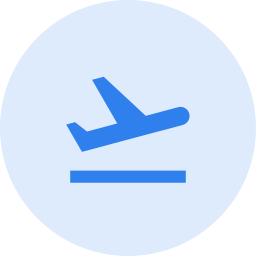</p>

<p align="center">
  
</p>

An airport **departures and arrivals board** for Home Assistant, under an animated illustration of the airport: the plane takes off on the Departures tab and lands on the Arrivals tab, by day or under the stars.

The cards are built on top of the [FlightRadar24 integration](https://github.com/AlexandrErohin/home-assistant-flightradar24): track an airport there, add the card, and its sensors are **discovered automatically**, whatever their names and your Home Assistant language.

[](https://my.home-assistant.io/redirect/marketplace_repository/?owner=juju35&repository=ha-flight-board-card&category=plugin)

| Departures | Arrivals |
|---|---|
| <picture><source media="(prefers-color-scheme: dark)" srcset="https://raw.githubusercontent.com/juju35/ha-flight-board-card/main/screenshots/card-dark.png">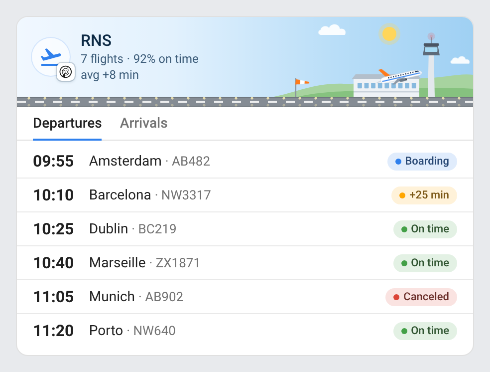</picture> | <picture><source media="(prefers-color-scheme: dark)" srcset="https://raw.githubusercontent.com/juju35/ha-flight-board-card/main/screenshots/card-arrivals-dark.png">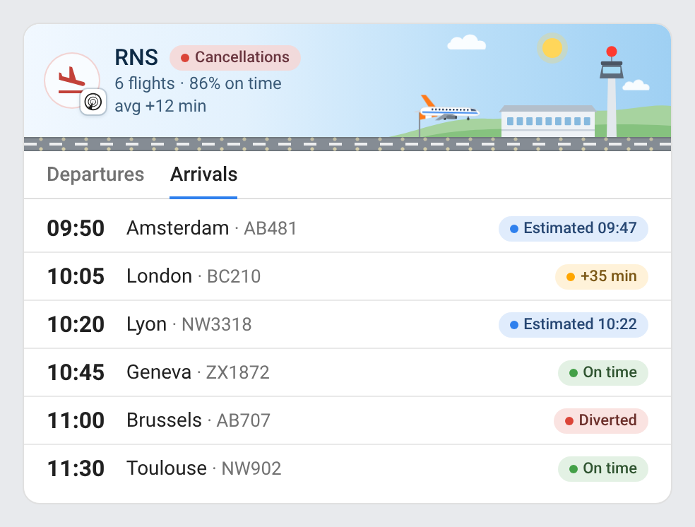</picture> |
| <picture><source media="(prefers-color-scheme: dark)" srcset="https://raw.githubusercontent.com/juju35/ha-flight-board-card/main/screenshots/mini-card-dark.png">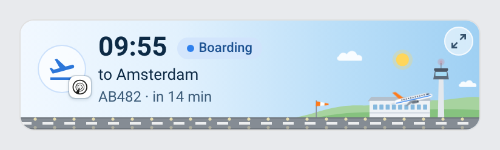</picture> | <picture><source media="(prefers-color-scheme: dark)" srcset="https://raw.githubusercontent.com/juju35/ha-flight-board-card/main/screenshots/mini-card-night-dark.png">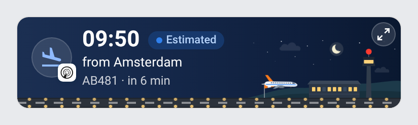</picture> |

## Features

- Two cards: a full **Flight Board Card** and a compact **Flight Board Mini Card**, of type `custom:flight-board-card` and `custom:flight-board-mini-card`
- The illustration is the header: sky, hills, a terminal with its windows, a control tower with its blinking red beacon, an orange windsock waving in the wind, the sun or the moon, drifting clouds, and a runway with its markings and pulsing edge lights
- A detailed plane (white fuselage, blue cheatline, orange tail, windows, engine) rolls down the runway and **takes off** on the Departures tab, or comes down, **lands** and rolls out on the Arrivals tab; the animation starts again when you switch tabs
- **Night mode** of the illustration: midnight-blue sky, stars, moon, the terminal and the tower lit in amber, the runway lights fully on, white header texts; it follows the sun (`sun.sun`), else the dark theme of Home Assistant, or is forced with `illustration_theme`
- Header with the airport code (or your title) and the board's statistics: « 7 flights · 92 % on time · avg +8 min », from the integration's statistics sensors when they have values, else computed from the listed flights
- **Departures / Arrivals** text tabs right under the header, the active one underlined
- One line per flight: the scheduled time in bold, the city with the flight number (and optionally the airline and the aircraft type), and a coloured status pill: **on time** (green), a delay such as **+25 min** (orange), **boarding**, **departed**, **landed** and **estimated** (blue), **canceled** and **diverted** (red)
- Click a flight for its detail, in a popup at the top of the card: airline, aircraft and registration, callsign, scheduled, estimated and actual times, and the full airport name; it closes with its button, a click anywhere else, Escape, or when the card leaves the page
- Mini card: the next flight laid on the sky (time, « to » or « from » city, flight number, « in 23 min », status pill) with a detail button at the top right that unfolds the full board; a click anywhere outside the card folds it back
- The FlightRadar24 radar mark as a badge on the header icon, on a white tile readable in both themes
- `illustration: false` for a classic header with a round icon, as on the other cards
- Visual editor for both cards (no YAML needed); options left at their default are kept out of the YAML
- Light and dark themes, `prefers-reduced-motion` honoured (the plane stays still, mid-flight)
- English, French, German, Spanish, Serbian (Cyrillic and Latin), Italian, Dutch, European Portuguese, Polish, Romanian, Danish, Swedish, Bulgarian, Russian, Ukrainian, Hungarian, Slovak, Czech, Slovenian, Latvian and Greek, flight statuses included
- Single file, no external dependency: the illustration is drawn in SVG, no picture or logo is loaded

## Supported integrations

| Integration | What the cards show |
|---|---|
|  [FlightRadar24](https://github.com/AlexandrErohin/home-assistant-flightradar24) (Marketplace) | The `flights` attribute of the **Airport departures** and **Airport arrivals** sensors (the next 50 flights of each board), the **Airport track** entity (the airport code), and the airport's statistics sensors (**on time**, **delayed**, **delay average**) |

## Prerequisites

- Home Assistant 2024.8 or later
- The [FlightRadar24 integration](https://github.com/AlexandrErohin/home-assistant-flightradar24), with an airport tracked: enter its IATA or ICAO code (for example `RNS` or `LFRN`) in the integration's **Airport track** entity

## Installation

### Via the Marketplace (recommended)

Click the button below to add the repository directly:

[](https://my.home-assistant.io/redirect/marketplace_repository/?owner=juju35&repository=ha-flight-board-card&category=plugin)

Then click **Install**, and reload your browser when the Marketplace asks you to.

Or manually:

1. Open **Settings → Marketplace → Add from link** (top right; this needs a GitHub account connected)
2. Add `https://github.com/juju35/ha-flight-board-card` — Category: **Dashboard** (Lovelace)
3. Open **Flight Board Card** and click **Install**
4. Clear your browser cache and refresh

The Marketplace registers the dashboard resource for you (`/local/community/ha-flight-board-card/flight-board-card.js`); the single file provides both cards.

### Manual

1. Download `flight-board-card.js` and the `flight-board-card.i18n.*.js` translation files from the [latest release](https://github.com/juju35/ha-flight-board-card/releases/latest)
2. Copy them all to `/config/www/` (without the translation files, the cards show in English)
3. Go to **Settings → Dashboards → ⋮ → Resources** → Add resource:
   - URL: `/local/flight-board-card.js`
   - Type: **JavaScript Module**
4. Clear your browser cache and refresh

## Configuration

### Visual editor

Edit a dashboard, click **Add card** and search for **Flight Board Card** or **Flight Board Mini Card**. The FlightRadar24 sensors are found by themselves; pick other ones if you have several FlightRadar24 entries, then set the title, the default tab, the number of flights, the illustration theme, the options to show and the language. The preview updates live, and options left at their default are kept out of the generated YAML. The mini card's editor also has the full card's options, used by its unfolded view.

### Minimal

```yaml
type: custom:flight-board-card
```

```yaml
type: custom:flight-board-mini-card
```

### Full options

```yaml
type: custom:flight-board-card
departures_entity: sensor.flightradar24_airport_departures
arrivals_entity: sensor.flightradar24_airport_arrivals
airport_entity: text.flightradar24_airport_track
title: Rennes
default_tab: departures
show_departures: true
show_arrivals: true
max_flights: 6
hours_ahead: 6
show_past: false
show_airline: true
show_aircraft: false
show_stats: true
illustration: true
illustration_theme: auto
language: en
```

```yaml
type: custom:flight-board-mini-card
title: Rennes
default_tab: arrivals
illustration_theme: night
max_flights: 8
zoom: true
```

### Options reference

| Option | Card | Default | Description |
|---|---|---|---|
| `departures_entity` | both | Discovered | The FlightRadar24 **Airport departures** sensor. Found in the entity registry (whatever its name), else `sensor.flightradar24_airport_departures` |
| `arrivals_entity` | both | Discovered | The FlightRadar24 **Airport arrivals** sensor, found the same way |
| `airport_entity` | both | Discovered | The FlightRadar24 **Airport track** text entity, whose airport code titles the card |
| `title` | both | Airport code | Card title (the airport code then shows beside it) |
| `default_tab` | both | `departures` | Tab shown first: `departures` or `arrivals`; on the mini card, the board of the next flight |
| `show_departures` | both | `true` | The Departures tab |
| `show_arrivals` | both | `true` | The Arrivals tab (with one tab only, no tab bar is shown) |
| `max_flights` | both | `6` | Number of flights listed (1 to 50); on the mini card, in its unfolded view |
| `hours_ahead` | both | No limit | Only the flights expected within this many hours |
| `show_past` | both | `false` | Also list the flights that have already departed or landed |
| `show_airline` | both | `false` | The airline's name after the flight number |
| `show_aircraft` | both | `false` | The aircraft type after the flight number |
| `show_stats` | both | `true` | The statistics line of the header (flights, on-time share, average delay) |
| `illustration` | both | `true` | The animated illustration as header; `false` for a classic header with a round icon |
| `illustration_theme` | both | `auto` | `auto` (night when `sun.sun` is below the horizon, else with the dark theme of Home Assistant), `day` or `night` |
| `zoom` | mini | `true` | Detail button at the top right: unfolds the full board and back (`false` removes it). The full card's options above apply to the unfolded view and are also set in the mini card's visual editor |
| `language` | both | Auto | Force language: `en`, `fr`, `de`, `es`, `sr`, `sr-Latn`, `it`, `nl`, `pt`, `pl`, `ro`, `da`, `sv`, `bg`, `ru`, `uk`, `hu`, `sk`, `cs`, `sl`, `lv` or `el` (auto-detects from HA settings) |

Every option is in the visual editor: none of them is YAML only.

## Screenshots

### Animations

The plane takes off on the Departures tab and lands on the Arrivals tab, in an 8-second loop that starts again when you switch tabs; the beacon blinks, the windsock waves, the clouds drift and the runway lights pulse. At night, the stars twinkle and the terminal and the tower are lit. With `prefers-reduced-motion`, everything stays still.

Take-off (Departures, day):

| Light | Dark |
|---|---|
| 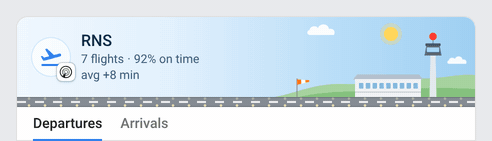 | 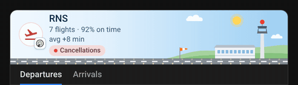 |

Landing (Arrivals, day):

| Light | Dark |
|---|---|
| 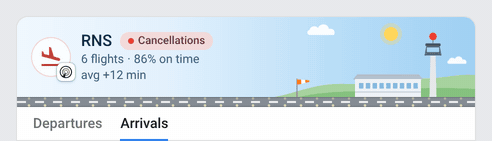 | 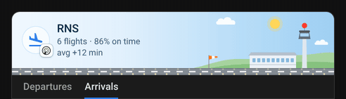 |

Night:

| Light | Dark |
|---|---|
| 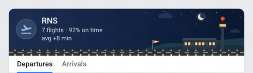 | 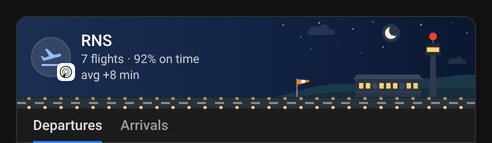 |

Mini card:

| Light | Dark |
|---|---|
| 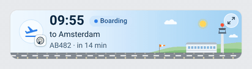 | 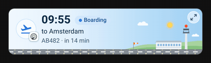 |

### Flight Board Card

| Light | Dark |
|---|---|
|  | 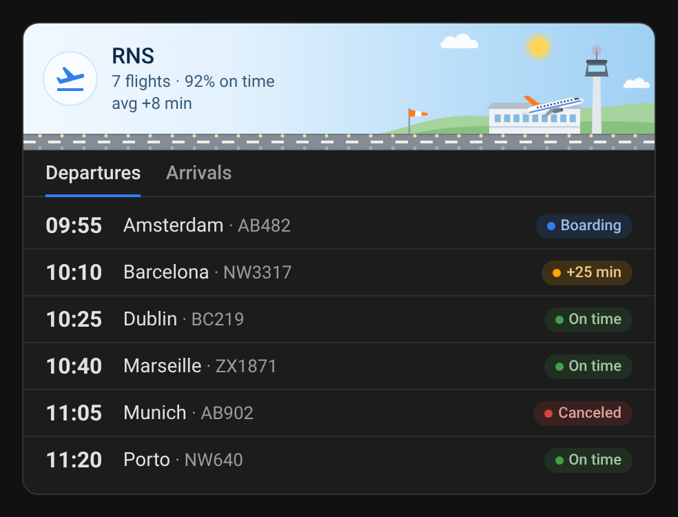 |
|  | 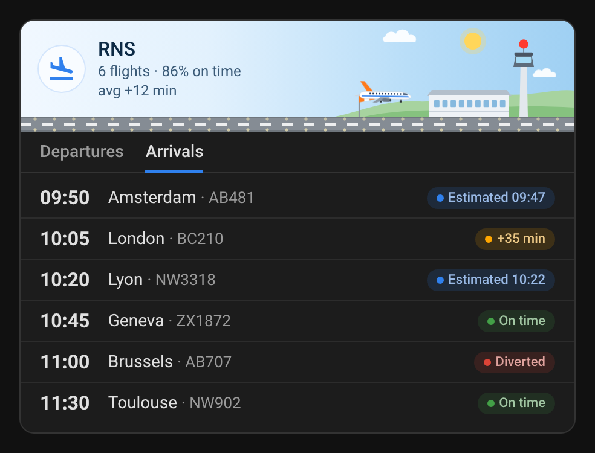 |

Night illustration (`illustration_theme: night`, or automatic after sunset):

| Light | Dark |
|---|---|
| 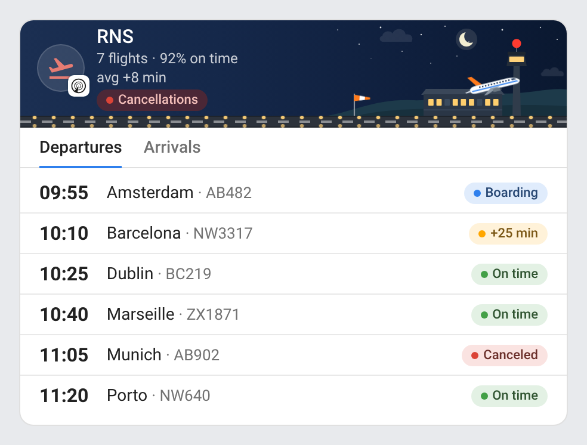 | 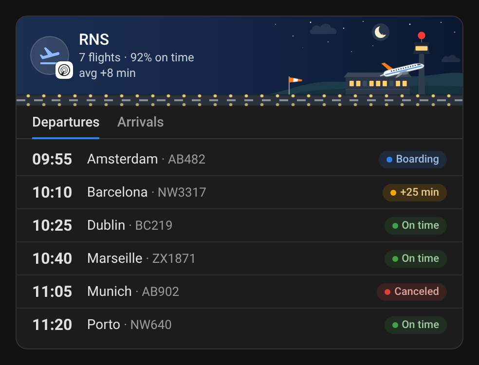 |

Detail of a flight, at the top of the card:

| Light | Dark |
|---|---|
| 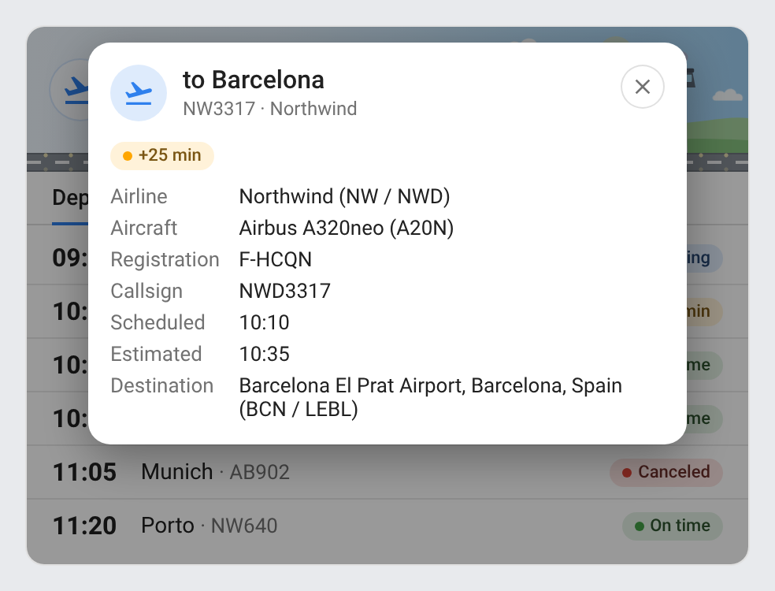 | 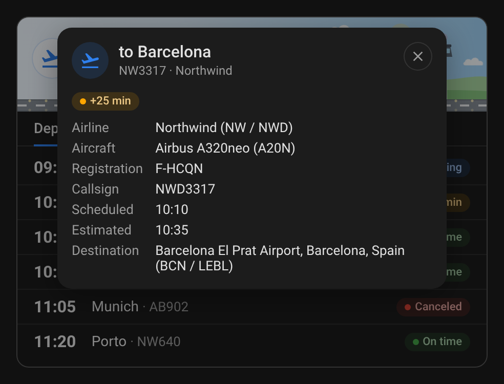 |

Classic header (`illustration: false`, here with `show_airline: true`):

| Light | Dark |
|---|---|
| 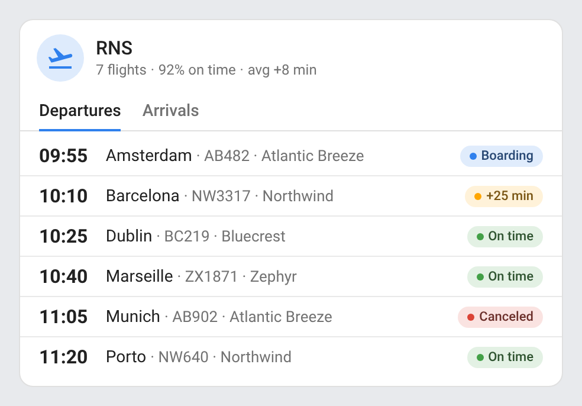 | 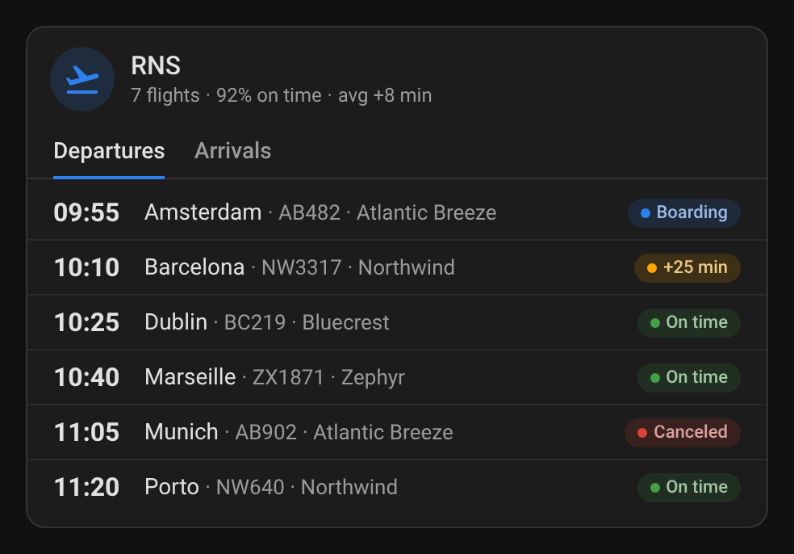 |

### Flight Board Mini Card

| Light | Dark |
|---|---|
|  | 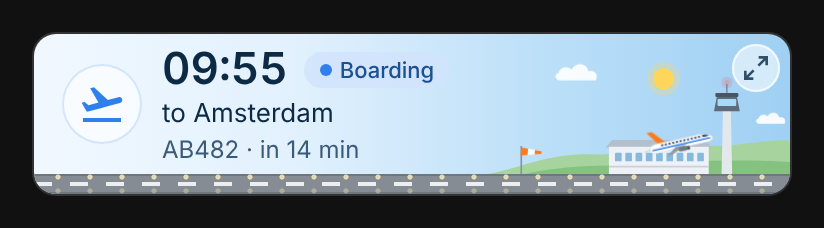 |
|  | 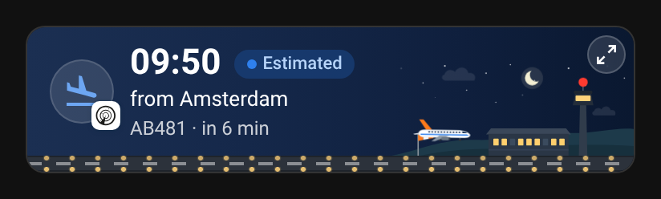 |

Unfolded with its detail button (top right; click it again or anywhere outside the card to go back):

| Light | Dark |
|---|---|
| 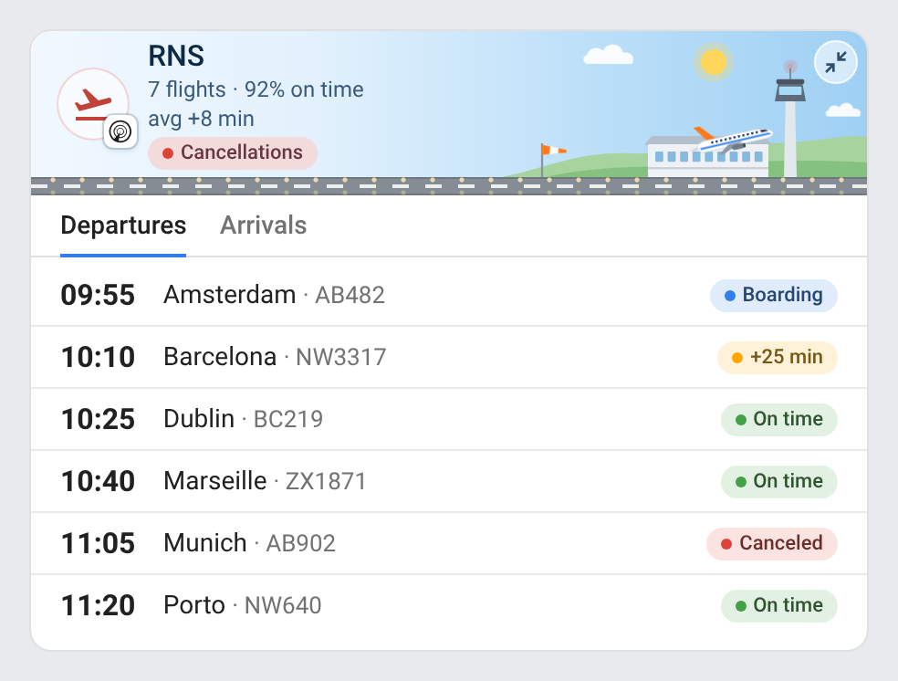 | 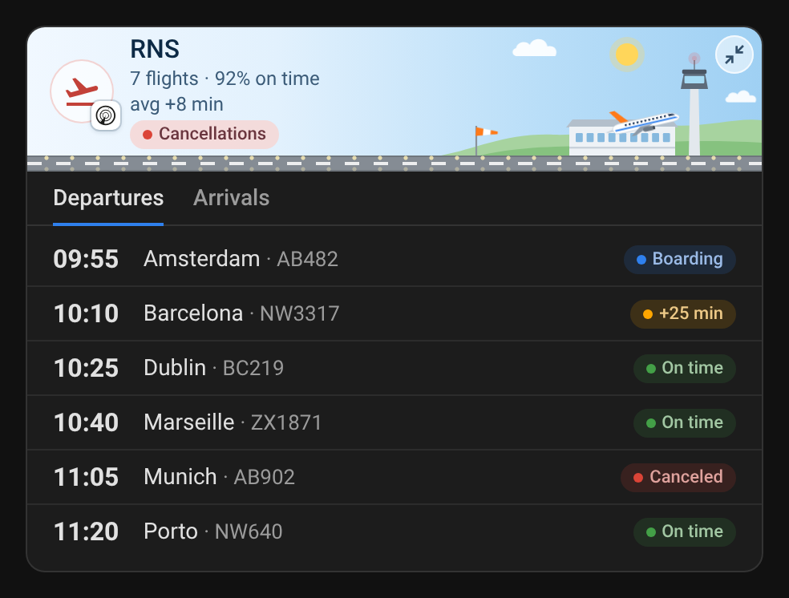 |

## How it works

### Entities

The FlightRadar24 integration creates its airport entities once an airport is tracked. The cards find them in the entity registry by their platform (`flightradar24`) and translation key (`airport_departures`, `airport_arrivals`, `airport_track`, `airport_departures_on_time`, `airport_departures_delay_average`…), so renamed or localised entities are found too; without a registry entry, they fall back on the integration's default entity ids (`sensor.flightradar24_airport_departures`, `sensor.flightradar24_departures_delay_average`, `text.flightradar24_airport_track`…). With several FlightRadar24 entries, set `departures_entity` and `arrivals_entity`: the statistics sensors and the airport entity are then taken from the same device.

While no airport is tracked, the board asks for one; when no FlightRadar24 sensor exists at all, the card says so.

### Times and statuses

Each flight of the `flights` attribute carries its scheduled, estimated and actual times (Unix timestamps, any of them may be missing). The card shows the scheduled time, in Home Assistant's time zone and 12/24-hour setting, and works out the status:

| Status | When | Colour |
|---|---|---|
| On time | Scheduled, or expected less than 15 minutes late | Green |
| +25 min | Estimated or actual time 15 minutes or more after the scheduled one (or the integration says delayed) | Orange |
| Boarding | A departure expected within the next 30 minutes (FlightRadar24 has no boarding status) | Blue |
| Departed / Landed | The flight has its actual departure / arrival time | Blue |
| Estimated | An arrival in the air, with its estimated time | Blue |
| Canceled / Diverted | From the integration's status | Red |

Flights that have departed or landed, or whose time is more than an hour gone, are left out unless `show_past` is on; they are sorted by scheduled time. The statistics line counts the listed flights; the on-time share and the average delay come from the airport's statistics sensors of the day when they have values, else from the listed flights. The relative times (« in 23 min ») and the boarding status follow the clock.

### Illustration

The banner is drawn in SVG and CSS, with no picture: the scenery keeps the right part of the header and is never under the texts. Every animation lasts a divisor of the plane's 8-second cycle. The scenery is left out on a very narrow card (below about 300 px, 280 px for the mini card), where the sky and the runway stay.

### Narrow cards

The full card fits down to 8 columns of a sections view (about 208 px on a phone), the mini card down to 6 columns (about 156 px). The statistics take two lines when they do not fit on one, the flight lines shorten their city with an ellipsis, and the status pills keep their colour. In a container sized by its content, the cards take a width of 400 px instead of collapsing.

## Development

```bash
npm install
npm run build        # bundles src/flight-board-card.js into dist/flight-board-card.js and stamps the version of package.json
npm run check        # builds and checks the bundle (run in CI)
npm test             # unit tests, and the browser layout tests (Chromium through Playwright)
npm run screenshots  # renders the cards with mock data (scripts/screenshots/mock.mjs) into screenshots/, and the animation GIFs (needs ffmpeg)
```

`dist/` is not committed: `npm run build` creates it locally, CI builds it on every push, and the release workflow attaches the built file to the release, which is where the Marketplace installs it from. The **Screenshots** workflow renders the captures again on every pull request that changes the sources and commits them to its branch.

### Releasing

1. Bump `version` in `package.json` (and `package-lock.json`)
2. Add a `## <version>` section at the top of [CHANGELOG.md](https://github.com/juju35/ha-flight-board-card/blob/main/CHANGELOG.md)
3. Merge to `main`: the **Release** workflow builds the card, creates the tag and the GitHub release with the changelog section as notes, and attaches `flight-board-card.js` and its translation files

## Translations

The cards auto-detect the language from your Home Assistant settings. Currently supported:

| Language | Code |
|---|---|
| English | `en` |
| Français | `fr` |
| Deutsch | `de` |
| Español | `es` |
| Српски (Serbian, Cyrillic) | `sr` |
| Srpski (Serbian, Latin) | `sr-Latn` |
| Italiano | `it` |
| Nederlands | `nl` |
| Português (Portugal) | `pt` |
| Polski | `pl` |
| Română | `ro` |
| Dansk | `da` |
| Svenska | `sv` |
| Български | `bg` |
| Русский | `ru` |
| Українська | `uk` |
| Magyar | `hu` |
| Slovenčina | `sk` |
| Čeština | `cs` |
| Slovenščina | `sl` |
| Latviešu | `lv` |
| Ελληνικά | `el` |

Contributions for additional languages are welcome!

## Contributing

Issues and pull requests are welcome: bug reports with your card configuration and a browser console extract, ideas, and translation fixes. Before opening a pull request, run `npm test` and `npm run check`; the screenshots are rendered by the CI on the pull request.

## Credits

Card idea by [mielikki33](https://github.com/mielikki33). Flight data from the [FlightRadar24 integration](https://github.com/AlexandrErohin/home-assistant-flightradar24) by AlexandrErohin. Flightradar24 and its logo are trademarks of Flightradar24 AB; this project is not affiliated with Flightradar24. The airlines, flight numbers and registrations of the screenshots are fictional.

## License

[MIT](https://github.com/juju35/ha-flight-board-card/blob/main/LICENSE)

## Support

If you find this project useful, you can support its development:

<a href="https://buymeacoffee.com/julienstep9"></a>
